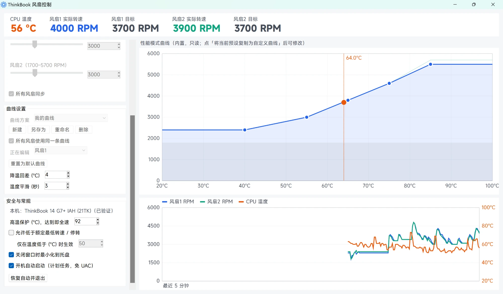

# ThinkBook 风扇控制

通过联想 BIOS WMI 接口 `LENOVO_OTHER_METHOD`（`root\WMI`）**按 RPM 精确设定每个风扇的转速**，支持预设模式、固定转速和自定义温度曲线；同时显示 CPU 频率 / 占用 / 实时功耗 / PL1·PL2，可以设定 PL1 / PL2 / Tau、按电源模式和是否插电限制 CPU 最高频率，把数据提供给 HWiNFO，并可以用命令行工具 `tbfc.exe` 在本机或远程控制。

单个 exe，无需安装，只依赖 Windows 自带的 .NET Framework 4.x。功耗读取 / PL 设置和旧机型的 EC 控制需要 [PawnIO](https://pawnio.eu) 驱动，程序内置了官方安装程序，可一键安装（见下文）。



## 使用

1. 从 [Releases](../../releases) 下载 `ThinkBookFanControl.exe`，或按下文自行编译
2. 双击运行（需要管理员权限，会弹出 UAC）
3. 选择模式：安静 / 均衡（系统默认）/ 性能 / 全速 / 固定转速 / 自定义温度曲线
4. 需要常驻的话勾选「开机自动启动」，关闭窗口后程序留在托盘

> **免责声明**：本程序直接改写 EC 的风扇目标转速和 CPU 功耗限制。不当设置（尤其是低速 / 停转、过高的 PL）可能导致硬件过热，请自行承担风险。程序内置高温保护和守护进程，但不能替代你对温度的留意。

## 适用机型

程序启动时按下面的顺序自动选择第一个可用的接口，「安全与常规」里会显示本机型号和正在使用的接口。

| 机型 | 接口 | 功能 | 状态 |
|---|---|---|---|
| ThinkBook 14+ 2025（ThinkBook 14 G7+ IAH，21TK） | 联想 BIOS WMI | 按 RPM 设定、读取转速 | ✅ 已验证 |
| ThinkBook 14+ / 16+ 2024、16+ 2025 等有 `LENOVO_FAN_TEST_DATA` 的机型 | 联想 BIOS WMI | 同上 | ❓ 未测试，可能适用 |
| ThinkBook 14+ / 16+ 2022–2023（G4+ IAP / G5+） | EC PWM 寄存器（需 PawnIO） | 按 % 占空比设定（每秒重写），无转速读数 | 🧪 实验性，未验证 |
| ThinkBook 14p / 16p 2021–2022（G2 ACH / G3 ARH） | EC 转速寄存器（需 PawnIO） | 按 RPM 设定、读取转速 | 🧪 实验性，未验证 |
| 其他带 `\\.\EnergyDrv` 的联想笔记本 | EnergyDrv（联想电源管理驱动） | 只有 自动 / 全速 | 🧪 实验性 |

EC 寄存器接口只在 `Win32_ComputerSystem.SystemFamily` 匹配上述机型、并且 EC 芯片 ID 像 ITE EC 时才会启用，未知机型不会写 EC。未验证机型请先在「固定转速」下确认实际转速能跟随目标，再使用曲线和低速功能。

**诊断信息**：在管理员命令行运行下面的命令，会生成只读的诊断报告（不改变风扇和功耗设置），反馈兼容性时请附上：

```
ThinkBookFanControl.exe --diag report.txt
```

## CPU 监控与 PL1 / PL2

| 项目 | 来源 | 需要 |
|---|---|---|
| 频率 | 性能计数器 `Processor Information(_Total)`：`Processor Frequency × % Processor Performance` | — |
| 占用率 | 性能计数器 `% Processor Utility`（与任务管理器一致） | — |
| 实时封装功耗 | Intel RAPL：MSR `0x611` 能量计数器的差值 ÷ 时间（单位来自 `0x606`） | PawnIO |
| PL1 / PL2 读取 | MSR `0x610`（另外读取 MCHBAR + `0x59A0` 的 MMIO 副本，仅显示） | PawnIO |
| PL1 / PL2 / Tau 设置 | 写 MSR `0x610`（PL1 bits 14:0、Tau bits 23:17、PL2 bits 46:32）；BIOS 设置了锁定位（bit 63）时只能读取，界面显示「不支持设置」 | PawnIO + 未锁定的 BIOS |
| PL1 / PL2（联想 WMI） | `LENOVO_CAPABILITY_DATA_01` 列出 `0x0102FF00` / `0x0101FF00` 的机型（Legion 风格）；ThinkBook 14+ 2025 不提供 | 「自定义」性能模式 |

- Tau 用下拉框选择，列出 1–448 秒之间硬件能精确表示的整数值（1–8、10、12、14、16、20、24、28、32、40…448）。
- 打开「自定义 PL1 / PL2」后，程序会持续保持设定值（BIOS、Intel DTT、Fn+Q 改回时会再次写入）；关闭选项或退出程序时把 MSR `0x610` 原样写回接管前的值（包括 Tau 和使能位）。
- 联想进程管理服务在本机的设置是 `Policy_DisablePLx = 1`，不会改 PL，所以 MSR 写入不会被它改回。
- 实测（ThinkBook 14+ 2025，Core Ultra 9 285H，平衡模式插电）：
  - 原值：MSR PL1 25 W / PL2 35 W / Tau 8 秒，MMIO PL1 53–58 W（由 Intel DTT 动态调整）/ PL2 75 W。这里 MSR 那组更低，所以写 MSR 直接生效；PL1 设到 MMIO 值以上则以 MMIO 为准。
  - 写入 40 / 60 W、Tau 56 秒后保持不变，没有被 BIOS / DTT / 联想服务改回。
  - PL1 = PL2 = 20 W 时满载封装功耗稳定在 20.0 W。
  - PL1 35 W / PL2 50 W / Tau 8 秒时，满载先以 50 W 运行约 3 秒，然后回落并稳定在 35 W。
  - 恢复后 MSR `0x610` 与接管前逐位一致。
- CPU 的 PL1、PL2 各自按 MSR 和 MMIO 两份中**较低**的生效（例如 MSR 25 / 35 W、MMIO 24 / 70 W 时实际是 24 / 35 W，界面会显示「实际生效」）。如果 MMIO 值更低（例如 Intel DTT 在调节，或 EC 到温度墙时改写），只改 MSR 不会提高实际功耗上限；PawnIO 的 MCHBAR 模块是只读的，本程序不改 MMIO。
- AMD 机型目前不支持功耗读取和 PL 设置。

## CPU 最高频率（P 核和 E 核一起限制）

按「电源模式（最佳能效 / 平衡 / 最佳性能）× 插电 / 电池」用下拉框选择 CPU 最高频率（从本机最高睿频起每 200 MHz 一档，或「不限制」），每种情况分「平时」和「全核满载」两个上限：

- **平时**：除全核满载以外都用这个上限，包括单线程跑分、游戏和日常使用。
- **全核满载**：每 0.25 秒统计一次所有逻辑处理器加起来忙了几个核心，最近 0.5 秒平均达到逻辑处理器数的 70%（本机 16 个 → 11.2 个核心；16 线程满载实测 14 个，两个低功耗 E 核不参与）就换成这个上限，最近 1 秒平均降到一半（8 个）以下就换回平时的上限；选「同平时」表示不另外限制，这个上限不会高于平时的。例如「平衡 · 插电」平时不限制、全核满载 3.0 GHz：跑分的单线程和游戏不受影响，只有烤机 / 多线程跑分 / 渲染这类全核负载才降到 3.0 GHz。
- 早期版本在约 2.5 个核心忙时就切换，CPU-Z 单线程测试加上后台程序就有 2.5 个，结果单核跑分也被限制，所以改成只看全核满载。
- 硬件里按活跃核心数限频的寄存器（MSR `0x1AD`）PawnIO 不允许写，所以由本程序按负载切换 Windows 的频率上限。全核负载开始后 0.25–0.5 秒切换，频率约再过 0.3–1.4 秒降到位，所以多线程测试的最开始一瞬间仍是高频；负载结束约 1 秒后换回平时的上限。
- **负载怎么算**：用每个逻辑处理器空闲线程的周期计数（`QueryIdleProcessorCycleTime`）。这台机器上任务管理器 / 性能计数器用的 `% Processor Time`（按时钟中断统计）严重少算：一个满载线程只显示 0–0.2 个核心，2–4 个满载线程几乎是 0，只有全部核心满载时才准；早期版本用它判断，导致单线程负载有时要等好几秒才换回原来的上限（CPU-Z 单核跑分开头很低、越跑越高）。每个逻辑处理器低于 15% 的占用视为后台噪声不计；本程序写入电源设置后 0.6 秒内的样本也不计（应用电源计划会让很多进程同时醒来）。

| | 写入位置 |
|---|---|
| 频率 | `PROCFREQMAX1` 和 `PROCFREQMAX`（同一个值） |
| 平衡 | 当前电源计划 |
| 最佳能效 / 最佳性能 | 对应的电源模式覆盖层（`961cc777…` / `ded574b5…`），覆盖层的值优先于电源计划（Windows 默认在「最佳能效 + 电池」下限制 3000 MHz） |

**为什么不能分别限制大小核**：用每个核心的 APERF / MPERF 实测（只让一个 P 核和一个 E 核满载）：

| P 核设置（`PROCFREQMAX1`）/ E 核设置（`PROCFREQMAX`） | P 核 | E 核 |
|---|---|---|
| 不限 / 不限 | 4658 MHz | 4475 MHz |
| 3800 / 2000 | 3678 MHz | 3700 MHz |
| 2000 / 不限 | 1991 MHz | 1900 MHz |
| 不限 / 2000 | 5094 MHz | 4501 MHz |

`PROCFREQMAX1` 同时限制所有核心（E 核约低 100 MHz），`PROCFREQMAX` 单独设置没有作用，所以 E 核不可能高于 P 核，界面也就只给一个上限。

每种情况的插电 / 电池值都写进去，切换电源模式或插拔电源时由 Windows 自己换用对应的值。程序监听电源设置的注册表变化，别的程序一改就立即处理（另外每 5 秒兜底检查一次）；关闭选项或退出时恢复原值。

**谁在改这些值**（实测）：是**联想进程管理服务**（`LenovoProcessManagement` / `LNVDispatcherService`），不是 Intel IPF / DTT。用 1 毫秒轮询记录频率上限，16 线程负载 5 秒、空闲 4 秒循环 5 次，逐个停用服务对比：

| 停用的服务 | 外部改写 |
|---|---|
| 无 | 每次负载结束后 1–2 秒写 4800，再过 1 秒写 5000 MHz，偶尔写 0（不限制） |
| Intel DTT（`dptftcs`） | 同上 |
| Intel IPF（`ipfsvc` / `ipf_uf.exe`） | 同上 |
| DTT + IPF | 同上 |
| 联想进程管理服务 | **没有** |
| 联想 + DTT + IPF | 没有 |

1. **策略开关**：它的注册表设置 `HKLM\SYSTEM\CurrentControlSet\Services\LenovoProcessManagement\Performance\PowerSlider\Policy_DisablePPMCtrl` 设为 `1` 并重启服务后，不再按电量 / 场景每隔几秒改写，但上面这种负载变化 / 打开程序时的改写仍然有。打开频率限制时程序会询问是否这样设置（也可以单独勾选「不让联想进程管理服务调节频率」）。
2. **停用服务**：勾选「停用联想进程管理服务（彻底不再改写频率上限）」会停止该服务并设为禁用，之后不再有任何外部改写，频率不会再被短暂拉高。代价是联想的应用加速 / 场景调度失效；Fn+Q 切换模式后 Windows 电源模式是否还跟着变尚未实测。取消勾选恢复原来的启动类型并启动服务。

两者都是系统设置，退出程序后仍保持。服务没停用时程序自己保持设定值：

- **不勾选「打开程序时允许系统临时加速」**：一被改动就立即改回（频率上限约 0.03–0.12 秒、EPP 约 0.1–0.2 秒；如果 1 秒内要改回 12 次以上，放慢到每 0.2 秒一次，避免两个程序互相死循环），但改写那一瞬间核心频率仍可能被短暂拉高。
- **勾选（默认）**：新打开的程序到前台后的 10 秒内（连续打开会延长，最长 30 秒）不改回，让系统临时加速，之后 1 秒内恢复设定值。注意：打开一个程序后 10 秒内就开始跑多核测试，开头会按 4.8 / 5.0 GHz 跑到窗口结束。对自定义 PL1 / PL2 同样适用（复查间隔 2 秒）。服务停用后频率上限不会再被临时提高。全核满载时不放行，一律立即改回。

联想服务停用后还剩 **Intel IPF / DTT 的处理器驱动**改写，规律很固定（实测）：全核满载约 5.3 秒时把上限改成「不限制」、EPP 改成 25；负载从全核降下来约 0.4 秒后、空闲约 1 秒后把上限改成 5.0 / 4.8 GHz、EPP 改成 25。

- 是谁：用 ETW 同时跟踪 RPC 调用和设置变化，每次改动前 5–15 毫秒都是同一个 `WUDFHost.exe` 在调用电源服务（umpo）写设置，它加载的是 `ipf_cpu.inf` 的 `ipf_umdf2.dll` / `ipfsrv.dll`，即「Intel(R) Innovation Platform Framework Processor Participant」（PCI 设备 `8086:7D03`，处理器热管理子系统）。DTT 服务 `dptftcs` 只是通过管道 `ipfsrv.dptftcs` 连到它的客户端，策略在驱动里运行。
- 怎么关：停用 `dptftcs`、`ipfsvc` 服务都没有效果（实测改写照旧），处理器参与者设备 Windows 标为关键系统设备、拒绝禁用；但禁用 DTT 的**扩展组件**（设备管理器 → 软件组件 → 「Intel(R) Dynamic Tuning Technology Device Extension Component」，DTT 的策略由它提供给 IPF）后，同样的负载连续 3 轮没有一次改写。勾选「停用 Intel DTT 扩展组件」就是做这个（`pnputil /disable-device`，和设备管理器里禁用一样，退出程序后仍保持；取消勾选重新启用）。代价是 DTT 的温度 / 功率管理策略不再生效，CPU 自身的温度墙和 EC 的风扇保护不受影响。
- **谁在写动态 PL**（实测，逐个重启服务并记录 MMIO）：联想进程管理服务启动约 2 秒后按当前模式写入（平衡 53 / 75 W），停止时写成 24 / 70 W；重启 DTT（`dptftcs`）、IPF（`ipfsvc`）服务都不变。把它配置里的 `Policy_NotifyBIOS`、`Policy_NamedPipe` 改成 0 也照样写（已改回）。BIOS 只在开机时写一次（本机 BIOS 设 100 / 150 W，开机时静态和动态都是 100 / 150 W）。所以要让本程序完全控制 PL：停用联想进程管理服务和 DTT 扩展组件后**重启一次**，除了下面 EC 的温度保护，动态 PL 就一直是 BIOS 的值，本程序设的静态 PL 低于它时都按本程序的值执行。代价是 Fn+Q 不再切换模式（Fn+Q 由联想进程管理服务处理），可用托盘菜单「电源模式」或 `tbfc power` 切换。
- **EC 也会写动态 PL**（读 DSDT 得出）：EC 事件 `_Q48` 的处理程序把 EC 内存里的 `PL1V` / `PL2V`（单位 W）乘 8 直接写进 MCHBAR + `0x59A0`（`CPL1` / `CPL2`），条件只是 EC 字段 `NSAP`、`MMCM` 为 0，和 DTT、联想服务都无关。到温度墙时 EC 就这样把动态 PL 改成 24 / 70 W，联想服务和 DTT 扩展组件都停用时也一样（联想服务停止时出现的 24 / 70 W 应该也是 EC 写的）。CPU 的 PL1、PL2 各自取静态和动态中较低的值，所以静态 25 / 35 W 时实际是 24 / 35 W：PL2 不会被抬到 70 W，只是 PL1 少 1 W；但静态 PL1 设得比 24 W 高时，实际 PL1 会被压到 24 W，什么时候恢复由 EC 决定。本程序写不了 MMIO，只在「CPU 功耗限制」里显示实际生效值，以及动态 PL 最近一次变化的时间、新旧值和当时的 CPU 温度。
- **注意 MMIO 功耗限制**：CPU 的 PL1 / PL2 有两份，MSR `0x610`（本程序写的、ThrottleStop 默认写的）和 MMIO（MCHBAR + `0x59A0`），CPU 按两者中较低的执行。HWiNFO 里分别叫「静态」和「动态」PL。DTT 运行时按 Fn+Q 模式设置 MMIO（平衡约 55 / 75 W）；禁用后 MMIO 不再随 Fn+Q 变化（实测平衡 / 最佳能效 / 最佳性能各停 15 秒，一直是 53 / 75 W），刚禁用时是 BIOS 默认的 25 / 35 W。实测 25 / 35 W 时自定义 PL 设 50 / 50 W，全核满载功耗仍是 35 W 约 8 秒后降到 25 W。PawnIO 的 MCHBAR 模块只能读，本程序写不了 MMIO，所以停用 DTT 时要在 BIOS 里把 PL1 / PL2 调高（BIOS 启动时会同时写 MSR 和 MMIO），本程序的值低于它时才按本程序的值生效。程序在「CPU 功耗限制」里发现 MMIO 更低时会提示。
- 不停用时程序的做法：约 0.03–0.12 秒内改回上限、0.1–0.2 秒内改回 EPP，信息栏显示的是改回后的值。

两个联想选项（策略、停用服务）是系统设置，退出程序后仍保持；程序启动时还会检查一遍，如果联想软件更新等把服务又打开了，会按你的选择重新停用。

联想默认在电池下关闭睿频（`Policy_DisableDCTurbo = 1` → `PERFBOOSTMODE` 电池值 = 0），此时高于基础频率的电池上限不起作用；勾选「电池供电时也允许睿频」会把插电时的睿频模式复制到电池（取消勾选恢复）。

**频率上限只能往下限，不能往上提**：选「不限制」只是去掉这个上限，实际能跑多高还取决于各电源模式的其他设置。本机读到的值（插电 / 电池）：

| 设置 | 平衡 | 最佳能效 | 最佳性能 |
|---|---|---|---|
| 处理器性能偏好 EPP（越大越省电、升频越慢） | 25 / 50 | 50 / 72 | 25 / 33 |
| 异构调度提升阈值（越大线程越倾向留在 E 核） | 0 / 0 | 2 / 3 | 254 / 1 |
| 频率上限 | 0 / 0 | 0 / 0 | 0 / 0 |

所以「最佳能效」下即使不限制，单核也难以跑到最高频率；联想还会随 Windows 电源模式切换自己的省电模式和 PL。要「往上提」就用下面的性能偏好。

## 性能偏好（EPP）

按「电源模式 × 插电 / 电池」用下拉框设定处理器能源性能偏好（`PERFEPP` / `PERFEPP1`，P 核和 E 核同一个值）：0 = 性能优先，越大越省电，100 = 最省电。数值越小，CPU 越积极升频，单核也更容易跑到高频；例如把「最佳能效」的 EPP 从 50 / 72 调到 25，这个模式下单核就能像平衡模式一样升频。

- 写入位置和频率上限相同（「平衡」写当前电源计划，「最佳能效 / 最佳性能」写对应覆盖层），Windows 随电源模式和插拔电源自动切换。
- 第一次打开时下拉框填的是系统当前值（本机：平衡 25 / 50，最佳能效 50 / 72，最佳性能 25 / 33），开启后不会立刻改变任何东西。
- 被其他程序（联想进程管理服务等）改回时立即写回；关闭选项或退出程序时恢复原值。和频率上限互相独立。
- 实测（平衡 · 插电，频率上限 3.0 GHz，一个 P 核满载）：EPP 100 → 2294 MHz，EPP 50 → 2893 MHz，EPP 0 → 2886 MHz（被 3.0 GHz 上限卡住）。

## 命令行控制（tbfc.exe）

`bin\tbfc.exe` 是不需要管理员权限的命令行工具，通过本程序的控制端口（默认 `27610`）操作正在运行的程序，适合脚本、快捷键工具或远程操作：

```
tbfc status                      # 温度、转速、模式、CPU、PL、频率上限
tbfc status --json               # 同上，JSON 格式
tbfc mode quiet                  # quiet / auto / performance / max / fixed / curve
tbfc fixed 3000                  # 固定转速（可加风扇号：tbfc fixed 3000 2）
tbfc profile "我的曲线"           # 切到自定义曲线方案
tbfc pl 35 50 28                 # 自定义 PL1 / PL2 / Tau 并开启；tbfc pl off 恢复
tbfc freq balanced ac 0 3000     # 平衡 + 插电：平时不限制、全核满载 3.0 GHz（平时 0 = 不限制，全核满载 0 = 同平时）；tbfc freq on / off
tbfc epp balanced ac 25          # 平衡 + 插电 的性能偏好（0 = 性能优先 … 100 = 省电）；tbfc epp on / off
tbfc power performance           # 切换 Windows 电源模式（efficiency / balanced / performance），代替 Fn+Q
tbfc boost off                   # 打开程序时不允许临时加速
tbfc dcturbo on | hwinfo on      # 电池睿频 / HWiNFO 传感器
tbfc quit                        # 交还 EC 自动控制并退出程序
tbfc help
```

- 每个请求都要带令牌。本机使用时 tbfc 自动从 `%AppData%\ThinkBookFanControl\settings.ini` 读取令牌和端口；也可以用 `--token` / `--port` 或环境变量 `TBFC_TOKEN` / `TBFC_PORT` 指定。
- 默认只监听 `127.0.0.1`。在「安全与常规」勾选「允许局域网访问」后监听所有网卡，并自动添加 Windows 防火墙规则（仅专用 / 域网络）；其他电脑用 `tbfc --host <本机 IP> --token <令牌> status`（令牌用「复制令牌」按钮获取）。也可以通过 SSH / PowerShell 远程在本机上运行 tbfc。
- 退出码：0 = 成功，1 = 程序拒绝了命令（参数错误、不支持等，原因输出到 stderr），2 = 连接不上或用法错误。
- 命令和界面走同一套设置，窗口里会同步显示命令改动的结果。

## PawnIO 驱动

读取 CPU 功耗、设置 PL1 / PL2、以及 2021–2023 旧机型的 EC 控制都需要访问 MSR / I/O 端口，必须通过内核驱动。本程序使用 [PawnIO](https://pawnio.eu)：签名驱动，**兼容「内存完整性」（HVCI）**，只运行签名的、带白名单的小模块（IntelMSR 只允许写 `0x610` 等少数 MSR；LpcIO 只允许访问 Super I/O 端口；LpcACPIEC 只允许 `0x62/0x66`）。WinRing0 / inpout 已被微软易受攻击驱动列表和 Defender 拦截，不再使用。

**内置安装**：exe 里内置了 PawnIO 官方安装程序 `PawnIO_setup.exe` 2.2.0（namazso 签名，SHA-256 `1F519A22…3032`，官方允许转发未修改的安装程序）。没装或版本较旧时，「CPU 功耗限制」里会出现「安装 PawnIO 驱动」按钮，点击后以 `-install -silent` 静默安装，然后重启本程序即可；旧机型（EC 风扇控制）启动时也会直接询问是否安装。也可以手动安装：[pawnio.eu](https://pawnio.eu) 或 `winget install namazso.PawnIO`。

驱动本身必须作为系统设备安装（`Root\PawnIO`），程序不会自己释放 `.sys` 或创建服务。所需模块（`IntelMSR` / `IntelMCHBAR` / `LpcIO` / `LpcACPIEC`）已内置在 exe 里（来自 [namazso/PawnIO.Modules](https://github.com/namazso/PawnIO.Modules) 0.2.11 的签名版本，LGPL-2.1，见 `res/pawnio/COPYING`）。没有安装 PawnIO 时，这些功能显示「--」/「不支持」，风扇控制（WMI 机型）照常工作。

**和 ThrottleStop 的区别**：ThrottleStop 不需要安装，是因为它每次运行时加载自带的 `ThrottleStop.sys`；这个驱动能任意读写物理内存（CVE-2025-7771，已被勒索软件用来关闭杀毒软件），所以它能写 MCHBAR 里的 MMIO 功耗限制（「MMIO Lock」「Sync MMIO」）。PawnIO 只允许写 MSR `0x610` 等少数寄存器，因此本程序只能改 MSR 那一组 PL，无法锁定 / 同步 MMIO；如果 MMIO 的值更低，以较低者为准（界面会同时显示两组值）。

## HWiNFO

勾选「在 HWiNFO 中显示」后，程序每秒把数据写入 HWiNFO 的自定义传感器注册表项
`HKCU\Software\HWiNFO64\Sensors\Custom\ThinkBook Fan Control`，HWiNFO 的传感器窗口里会多出一组「ThinkBook Fan Control」：

`Fan 1` / `Fan 2`（实际转速）、`Fan N Target`（目标，0 = 自动或停转）、`CPU`（温度）、`CPU Package Power`、`CPU PL1`、`CPU PL2`、`CPU Effective Clock`、`CPU Usage`

HWiNFO 只在启动时读取传感器列表，第一次打开这个选项后需要重启 HWiNFO。取消勾选会删除这些注册表项。这些值同样会进入 HWiNFO 的共享内存，RTSS / Rainmeter / FanControl 的 HWiNFO 插件等都能读到。

## 原理

| Feature ID | 读 | 写 |
|---|---|---|
| `0x0403_00XX` | 风扇 XX 当前转速 (RPM) | 目标转速 (RPM，100 步进)；`0` = 交还 EC 自动控制 |
| `0x0504_0000` | CPU 温度 (°C) | — |

风扇列表与额定转速上下限来自 `LENOVO_FAN_TEST_DATA`（已验证机型：ID 1 为 1800–5500 RPM，ID 4 为 1700–5700 RPM）；`LENOVO_CAPABILITY_DATA_00` 里没有「可写」位的风扇不会被控制。实测低于额定最低转速时：

| 写入 | 实际 |
|---|---|
| 1500 | 1400–1600，稳定 |
| 1000 | 800–1300，可用但有波动 |
| ≤ 500（含 1） | 风扇停转 |

默认把目标限制在额定范围内；打开「允许低于额定最低转速 / 停转」后，可设 1000 RPM 以上或 0 = 停转（写入 `1`），且仅在温度低于设定值（默认 50°C）时生效，超过即提回额定最低转速。

旧机型的 EC 寄存器（经 PawnIO 访问 ITE EC 的 D2EC 窗口 `0x4E/0x4F`，以及 ACPI EC `0x62/0x66`）：

| 机型 | 写入 | 读取 |
|---|---|---|
| ThinkBook 14+/16+ 2022–2023 | `0x1804` / `0x1805`：PWM 占空比 0–127（EC 会改回，需每秒重写；停止重写即交还 EC） | CPU 温度：ACPI EC `0x07` |
| ThinkBook 14p/16p 2021–2022 | `0xC83C` / `0xC83D`：目标转速 ÷ 100（`0` = EC 自动） | 转速 `0xC830..0xC833`，DTS 温度 `0xC41C` |

与 [jiarandiana0307/Lenovo-Fan-Control](https://github.com/jiarandiana0307/Lenovo-Fan-Control) 的区别：后者使用 `\\.\EnergyDrv` 的“除尘”功能，只能在“正常 / 全速”之间切换，无法设定具体转速（本程序把它作为最后的兼容接口）。

## 功能

- 模式：安静 / 均衡（系统默认，EC 控制）/ 性能 / 全速 / 固定转速 / 自定义温度曲线
- 预设曲线（内置只读，可一键复制为新的自定义曲线方案再修改）：

  | 温度 | 安静 | 性能 |
  |---|---|---|
  | 40°C | 最低（允许低速时 ≤45°C 停转） | 2400 |
  | 55°C | ~1870 | 3000 |
  | 65°C | 2000 | 3800 |
  | 75°C | 2600 | 4600 |
  | 85°C | 3600 | 最高 |
  | 92°C | 最高 | 最高 |
- 多套自定义曲线方案：新建 / 另存为 / 重命名 / 删除，托盘菜单「曲线方案」可直接切换
- 曲线编辑器：拖动点、双击添加、右键删除；可两风扇共用一条曲线或分别设置
- 温度平滑 + 降温回差，避免转速来回抖动（自定义曲线和安静 / 性能模式共用）
- **平滑调速**：目标转速按设定速率（默认升速 300 RPM/秒、降速 150 RPM/秒）逐步变化，不再突然加速 / 减速；高温保护时直接全速
- **CPU 监控**：频率、占用率、实时封装功耗、PL1 / PL2；功耗曲线和温度一起显示在历史图里
- **PL1 / PL2 / Tau 设置**（需 PawnIO，见上文）
- **CPU 最高频率**：按电源模式 × 插电 / 电池用下拉框限制（P 核和 E 核一起限制），被系统改写时自动处理，可选择是否允许打开程序时临时加速（见上文）
- **性能偏好（EPP）**：按电源模式 × 插电 / 电池设定，让省电模式下也能积极升频，或反过来更省电（见上文）
- **命令行控制**：`tbfc.exe`，本机或局域网远程（见上文）
- **HWiNFO 自定义传感器**（见上文）
- 高温保护：达到设定温度两风扇全速，回落 5°C 后恢复
- 连续读不到温度时，曲线类模式自动交还 EC
- 退出、注销/关机、程序异常时自动交还 EC；从睡眠唤醒后重新下发目标
- 守护进程（同一 exe 以 `--watchdog <pid>` 启动）：主程序退出、崩溃或被任务管理器结束后，立即把风扇交还 EC
- 托盘常驻，托盘图标跟随系统深色 / 浅色任务栏自动切换颜色；开机自启（计划任务，最高权限运行，免 UAC，电池供电也启动）
- 设置保存在 `%AppData%\ThinkBookFanControl\settings.ini`（自动迁移旧版 `LenovoFanCurve` 的设置和开机自启任务）

> ⚠ 如果主程序和守护进程同时被结束（例如“结束进程树”），EC 会保持最后一次写入的转速，直到重新运行程序或重启电脑。守护进程不恢复 PL1 / PL2：程序被强制结束时，设定的功耗限制保持到重启（BIOS 会重新设定）。

## 编译

只需 Windows 自带的 .NET Framework 4.x：运行 `build.cmd`，输出 `bin\ThinkBookFanControl.exe`（需要管理员权限运行）和命令行工具 `bin\tbfc.exe`（源码在 `cli\`，不需要管理员权限）。

图标由 `src\FanIcon.cs` 用代码绘制（托盘图标运行时生成），运行 `tools\make-icon.cmd` 重新生成 exe 图标 `res\app.ico`。

## 参考

- [jiarandiana0307/Lenovo-Fan-Control](https://github.com/jiarandiana0307/Lenovo-Fan-Control)、[FanControl.LenovoPlugin](https://github.com/jiarandiana0307/FanControl.LenovoPlugin)：EnergyDrv 全速 / 正常切换及保持全速的方法
- [markgoo/Thinkbook14PAutoFanController](https://github.com/markgoo/Thinkbook14PAutoFanController)：ThinkBook 14p 的 ITE EC 寄存器
- TB FanFun V2.6：ThinkBook 14+ 2022 的 EC PWM 寄存器
- [Gunther8/lenovo-fan-control](https://github.com/Gunther8/lenovo-fan-control)：`LENOVO_GAMEZONE_DATA.SetSmartFanMode`，面向联想台式机，切换的是整机性能模式而非风扇转速，未纳入
- [BartoszCichecki/LenovoLegionToolkit](https://github.com/BartoszCichecki/LenovoLegionToolkit)、Linux `lenovo-wmi-other`：联想 WMI 功耗限制的能力 ID
- [namazso/PawnIO](https://github.com/namazso/PawnIO)、[LibreHardwareMonitor](https://github.com/LibreHardwareMonitor/LibreHardwareMonitor)：PawnIO 的调用方式

## 反馈

如果你在其他机型上测试过（能用或不能用），欢迎提 Issue，附上 `--diag` 生成的诊断报告，或者机型（「安全与常规」里显示的型号）和 `LENOVO_FAN_TEST_DATA` 的输出。

## 许可证

[MIT](LICENSE)。内置的 PawnIO 模块为 LGPL-2.1（[源码](https://github.com/namazso/PawnIO.Modules)）。
